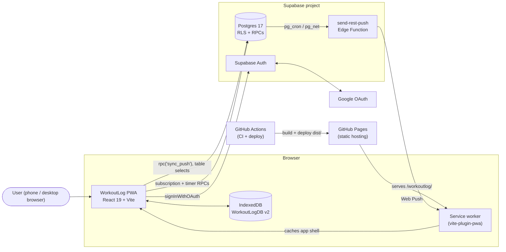
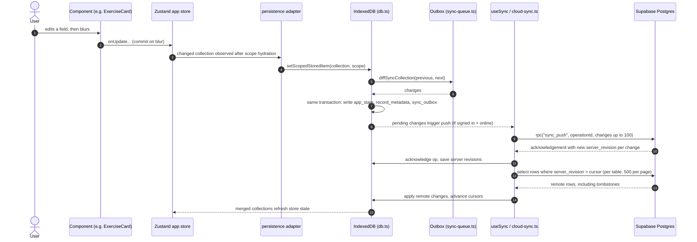
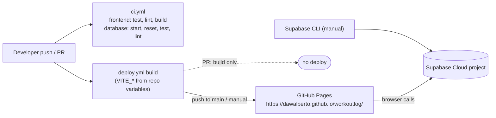

# Architecture overview

How WorkoutLog's parts fit together: a static React PWA that stores data locally in IndexedDB and, for signed-in users, syncs directly with Supabase.

Last verified: 2026-10-15

## In one paragraph

WorkoutLog is a single-page React 19 + Vite app served as static files from GitHub Pages. All user data (routines, exercise catalog, active sessions, RM logs, workout history, exercise diary) lives first in the browser's IndexedDB. Guests never touch the network. Signed-in users (Google OAuth via Supabase Auth) get every local change queued in an IndexedDB outbox and pushed to Postgres through one RPC (`sync_push`); remote changes are pulled per table by server revision. There is **no custom server**: Supabase (Auth, Postgres, RLS, RPCs) is the whole backend.

Server-side push dispatch uses the managed `send-rest-push` Supabase Edge Function; no custom server is needed. Signed-in clients register a browser subscription and schedule timer completion through authenticated RPCs, while guests continue to use local timer feedback.

## System context

## Components

| Component | Responsibility | Code |
|---|---|---|
| Composition root and shell | Boots lifecycle adapters, applies readiness gates, composes tabs and overlays | [`src/App.tsx`](../../src/App.tsx), [`src/components/AppShell.tsx`](../../src/components/AppShell.tsx) |
| App state | Zustand store composed from domain slices; narrow selectors and component hooks | [`src/store/`](../../src/store/appStore.ts) |
| Lifecycle adapters | Hydration/persistence, auth, sync, and rest-push scheduling; mounted once by app bootstrap | [`src/hooks/useAppBootstrap.ts`](../../src/hooks/useAppBootstrap.ts), [`src/store/persistence.ts`](../../src/store/persistence.ts), [`src/hooks/useRestPush.ts`](../../src/hooks/useRestPush.ts) |
| UI components | Feature containers and reusable presentation components (Spanish copy) | [`src/components/`](../../src/components/RoutineView.tsx) |
| Local DB service | IndexedDB stores, scopes, outbox, cursors, metadata | [`src/services/db.ts`](../../src/services/db.ts) |
| Sync queue | Diff collections → outbox changes, ordering, apply remote | [`src/services/sync-queue.ts`](../../src/services/sync-queue.ts) |
| Cloud sync | Push/pull against Supabase, retries, conflict handling | [`src/services/cloud-sync.ts`](../../src/services/cloud-sync.ts) |
| Supabase client / auth | Client factory (nullable), Google OAuth helpers | [`src/services/supabase.ts`](../../src/services/supabase.ts), [`src/services/auth.ts`](../../src/services/auth.ts) |
| Database | 12 owner-scoped tables, sync metadata trigger, RPCs | [`supabase/migrations/`](../../supabase/migrations/20261007135400_create_private_workout_data.sql) |

Details: [frontend](frontend.md), [backend](backend.md), [contract](frontend-backend-strategy.md).

## Data flow: lifecycle of a local edit

The state write, record metadata, and outbox entries are written in one IndexedDB transaction (`writeStoredItems`, [`src/services/db.ts`](../../src/services/db.ts) around lines 281–350). Guests stop there: the `guest` scope keeps its outbox but nothing is pushed; on first sign-in guest data and outbox move to the owner scope once (`transferGuestDataToOwnerOnce`). The exact algorithm, limits, and error handling are specified in the [frontend–backend strategy](frontend-backend-strategy.md).

Rest-timer Web Push is separate from workout-data sync: `useRestPush` observes the in-memory timer and signed-in identity, while a serial controller registers the subscription and reconciles one server schedule through dedicated RPCs. Timer state and push subscription details are not added to IndexedDB or the sync contract. The server sends the push through `send-rest-push`; the classic handler imported by the production service worker displays the system notification while the page can be suspended.

## Deployment topology

| Concern | How |
|---|---|
| Frontend | [`deploy.yml`](../../.github/workflows/deploy.yml) builds on push to `main`, PRs to `main`, and manual dispatch; deploys only when the event is not a PR. |
| Base path | Vite `base: '/workoutlog/'` ([`vite.config.ts`](../../vite.config.ts)). |
| Build config | `VITE_SUPABASE_URL`, `VITE_SUPABASE_PUBLISHABLE_KEY`, `VITE_VAPID_PUBLIC_KEY`, `VITE_GA_MEASUREMENT_ID` from GitHub repository **variables** (public values). |
| Database | Migrations are **not** applied by CI; apply production migrations before deploying frontend changes that depend on them. |
| Client updates | Service worker `registerType: 'autoUpdate'`; deployed clients may run an older bundle until the SW updates — see [evolving the contract](frontend-backend-strategy.md#evolving-without-breaking-clients). |

## Related

- [Frontend architecture](frontend.md)
- [Backend architecture](backend.md)
- [Frontend–backend strategy](frontend-backend-strategy.md)
- [ADR 0001 – Local-first IndexedDB](../decisions/0001-local-first-indexeddb.md)
- [ADR 0002 – Supabase-only backend](../decisions/0002-supabase-only-backend.md)
- [ADR 0003 – Static GitHub Pages PWA](../decisions/0003-static-github-pages-pwa.md)
- [Root README](../../README.md)
